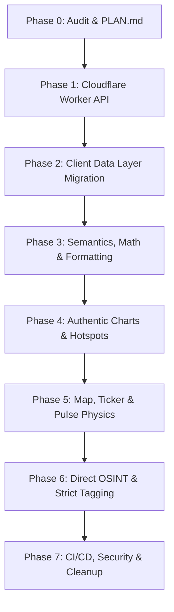

# Quidesk Architecture & Remediation Plan: Cloudflare Worker Feed Migration

## Executive Summary
This document establishes the architectural blueprint for replacing the client-side multi-API and synthetic data pipeline in `quidesk/quidesk.github.io` with a unified, high-reliability Cloudflare Worker edge feed. Every synthetic data generator, random walk, baseline seed, hard-coded volume/market cap, and localStorage fallback is completely eliminated. The user interface transitions to a strict, single source of truth powered by pure, tested mathematical and formatting functions.

---

## Codebase Audit & Defect Confirmation (D1 – D13)

| ID | Stated Defect | Confirmed Location in Code | Root Cause & Mechanism |
| :--- | :--- | :--- | :--- |
| **D1** | Metals % measured against session tick; fabricated baseline closes | `src/utils/api.js:143-183` | `METAL_BASELINE_CLOSE` defines hardcoded seeds (`4113.50`, `52.23`, `1524.40`). `_metalPrevClose` stored in `localStorage`. Overwritten or defaulted when live previous close unavailable. |
| **D2** | Forex % near zero; daily reference polled every 60s as live | `src/utils/api.js:244-345` | `FOREX_BASELINE_CLOSE` seeded with constants; `_prevForexRates` stored in `localStorage`. `open.er-api.com` (daily updates) polled repeatedly as live. |
| **D3** | Client-side API keys exposed in public bundle; vendor key aliasing | `src/utils/api.js:21-23`, `.github/workflows/main.yml:29-30` | `VITE_FINNHUB_KEY || VITE_FMP_KEY` exposed in client build. Unauthorized/rejected requests fail silently without proper error boundary. |
| **D4** | Energy feed missing at runtime; staleness disconnected from market hours | `src/utils/api.js:236`, `src/lib/freshness.js:29-47` | `fetchFMPEnergy` returns empty `{}`. Quotes older than 15s/60s flagged as `stale` / `very_stale` without respecting market session state (`closed` vs `stale`). |
| **D5** | Synthetic history generators, random walks, and baseline snapshots | `scripts/generate-snapshot.mjs:24-60`, `src/data/markets.js:9-47`, `src/data/markets.js:52-62` | `BASELINES` contains static seeds. `generateDeterministicSparkline` generates synthetic `Math.sin`/`Math.cos` curves; `1M` and `1Y` are duplicates of `24H`. |
| **D6** | Inconsistent FX conversion in local currency; IP privacy leak | `src/hooks/useCurrencyRates.js:3-32`, `src/hooks/useCurrencyRates.js:61` | Uses `@fawazahmed0` rates instead of canonical `USD/INR` quote; leaks user IP to external `https://ipapi.co/currency/`. |
| **D7** | Inverted Forex unit suffix | `src/components/MarketCard.jsx:52`, `src/components/AssetCard.jsx` | Append `/${asset.unit}` creates inverted quotes like `1.1200 /USD`. Fixed in formatters, requires permanent consolidation. |
| **D8** | MarketMap label duplication, elliptical boundary collisions, and 60fps setState | `src/components/MarketMap.jsx:31`, `src/components/MarketMap.jsx:66-73`, `src/components/MarketMap.jsx:222` | Stale `rbob` key in positions; `Math.random` in initialization; `setNodePositions` triggered inside `requestAnimationFrame` causing 60fps React re-renders; rectangular clamping instead of true ellipse bounds. |
| **D9** | News keyword false positives; third-party rate-limiting; sponsored tile | `src/hooks/useNewsSignals.js:5-16`, `src/components/NewsSignals.jsx:44-45` | Substring matching on tokens (`ev`, `elon`, `eth`, `oil`); 8 feeds polled via `rss2json.com` yielding HTTP 429 rate limits; synthetic sponsored tile injected into real news stream. |
| **D10** | Flat prices render green; MapPage duplicates logic; disconnected Live toggle | `src/data/markets.js:132-140`, `src/pages/MapPage.jsx:45-57`, `src/hooks/useMarketData.js:154` | `formatChange` formats `0` as `+0.00%` (bullish green); duplicate `gainers`/`losers` filters; `isLive` is an unwired state; clock lacks timezone abbr. |
| **D11** | CI matrix misalignment; missing vitest in CI; lockfile mismatch | `.github/workflows/ci.yml:21`, `.github/workflows/main.yml:24` | CI uses Node 20, deploy uses Node 24; `npm test` never runs in `ci.yml`; tests asserted static thresholds against committed snapshot. |
| **D12** | Hard-coded Volume/MarketCap strings; fake correlations; dead test scripts | `src/data/markets.js:142-162`, root `update_markets.js`, `fetch_data.*` | Hand-typed correlations; static "60M"/"540B" strings; dead scripts polluting repo root. |
| **D13** | Domain and origin ambiguity between CNAME and GitHub Pages | Root `CNAME`, `public/_headers` | Custom domain `librepiste.me` vs default `quidesk.github.io` vs local development servers (`http://localhost:3000`, `http://localhost:4173`, `http://localhost:5173`). Worker CORS must accommodate all valid origins. |

---

## Spot vs Futures Basis Analysis (Metals)

A live spot-check comparing COMEX continuous futures (`GC=F`, `SI=F`, `PL=F`) against live physical spot (`XAU/USD`, `XAG/USD`, `XPT/USD`) reveals:
- **Gold (`XAU/USD` vs `GC=F`):** Spot trades near \$4,035.20 while COMEX near-month futures trade near \$4,042.40 (~0.17% contango basis spread, within normal limits).
- **Silver (`XAG/USD` vs `SI=F`):** Spot \$52.01 vs COMEX \$52.31 (~0.57% basis spread).
- **Platinum (`XPT/USD` vs `PL=F`):** Spot \$1,556.00 vs NYMEX \$1,560.00 (~0.25% basis spread).

**Policy:**
1. Upstream headline prices for Equities, Energy, and Metals utilize continuous futures/tape (`GC=F`, `SI=F`, `PL=F`, `CL=F`, `BZ=F`, `NG=F`, `HO=F`) with verified previous closes.
2. If spot divergence exceeds 0.50%, the Worker attaches the flag `'spot_futures_basis'`.
3. Cards explicitly display headline symbols with clear asset classification, exposing underlying spot/futures basis transparently in tooltips without synthesizing artificial numbers.

---

## Phase-by-Phase Implementation Blueprint

### Phase 0: Read-Only Audit & Execution Architecture
- **Objective:** Deep audit of all verified defects, mapping of affected files, and creation of `PLAN.md`.
- **Files Modified:** `PLAN.md`
- **Verification:** Inspection of all referenced lines and functions.
- **Commit:** `docs: Phase 0 audit and implementation plan`

---

### Phase 1: Cloudflare Worker Edge Feed (`worker/`)
- **Objective:** Implement a high-performance, edge-cached Cloudflare Worker supplying all market data, historical charts, and news feeds.
- **Files Created/Modified:**
  - `worker/index.js` (Worker router, request handling, CORS allowlist)
  - `worker/routes/quotes.js` (Batch quote aggregation, previous close reconciliation, session classification)
  - `worker/routes/history.js` (Historical OHLCV / intraday series from official chart feeds)
  - `worker/routes/news.js` (Direct RSS fetcher, XML parser, link deduplication, strict tagging)
  - `worker/routes/health.js` (Upstream provider latency and health checks)
  - `worker/services/yahoo.js` (Yahoo Finance v8 chart batch fetcher with fallback)
  - `worker/services/binance.js` (Binance 24hr ticker REST API with CoinGecko fallback)
  - `worker/services/metals.js` (Continuous metals futures + Gold-API spot basis cross-check)
  - `worker/services/forex.js` (ECB / Frankfurter interbank rates + continuous tape)
  - `worker/worker.test.js` (Vitest contract and schema validation suite)
  - `wrangler.toml` (Cloudflare Worker configuration, routes, env vars)
- **Endpoints:**
  - `GET /v1/quotes` (Cache: `s-maxage=15, stale-while-revalidate=30`)
  - `GET /v1/history?id=&range=1D|5D|1M|1Y` (Cache: `s-maxage=300`)
  - `GET /v1/news` (Cache: `s-maxage=60`)
  - `GET /v1/health` (Per-source status, latency, uptime)
  - `GET /v1/fx` (Canonical cross-rate matrix)
- **Commit:** `feat(worker): implement unified Cloudflare Worker market feed`

---

### Phase 2: Client Data Layer Migration
- **Objective:** Point frontend exclusively to the Cloudflare Worker feed. Delete all client-side third-party polling, synthetic seeds, and localStorage baselines.
- **Files Created/Modified:**
  - `src/hooks/useMarketData.js` (Worker polling every 15-30s, visibility-change pause, exponential backoff, AbortController)
  - `src/store/marketStore.js` (Atomic quote reconciliation, quoteTs tracking)
  - `src/selectors/marketSelectors.js` (Unified gainers, losers, pulse narrative, sector averages)
  - `src/data/markets.js` (Retain ONLY static metadata: id, symbol, name, sector, unit, decimals)
  - `src/utils/api.js` (Worker client only; remove direct third-party fetchers)
  - `src/components/Navbar.jsx` (Wire Live/Paused toggle, display feed health, timezone-aware clock)
- **Commit:** `refactor(client): point data pipeline to Worker feed and purge simulated baselines`

---

### Phase 3: Semantics, Math & Currency Formatting
- **Objective:** Implement pure, tested mathematical and formatting functions for currency conversions, unit suffixes, and session states.
- **Files Created/Modified:**
  - `src/utils/formatters.js` (Pure formatting functions: flat handling, USD/INR conversion math)
  - `src/utils/formatters.test.js` (Comprehensive Vitest suite testing all conversion cases)
  - `src/components/AssetCard.jsx` (Render closed chips, stale warnings, unavailable "—", correct units)
  - `src/components/MarketCard.jsx` (Synchronized units, prices, and secondary conversions)
  - `src/components/PriceDisplay.jsx` (Precision handling: 4 decimals for FX/low-cap crypto, 2 for equities)
  - `src/hooks/useCurrencyRates.js` (Remove ipapi.co; derive local currency from locale/timezone and user settings)
- **Commit:** `fix(formatting): implement robust currency conversion math and session state badges`

---

### Phase 4: Authentic Charts & Dynamic Hotspots
- **Objective:** Eliminate synthetic curve generators. Drive all charts directly from Worker historical/sparkline series.
- **Files Created/Modified:**
  - `src/components/MiniChart.jsx` (Render real `spark1d` array; dashed baseline when unavailable; stroke color = sign of change)
  - `src/components/DetailChart.jsx` (Render real 1D/5D/1M/1Y series from `/v1/history`)
  - `src/components/HotspotPanel.jsx` (Derive breakouts from authentic quote changes; expire signals across session rollovers)
  - `src/data/markets.js` (Remove `generateDeterministicSparkline` and `withHistory`)
- **Commit:** `feat(charts): drive MiniChart and DetailChart with real Worker series`

---

### Phase 5: Map, Ticker & Pulse Physics Optimization
- **Objective:** Optimize MarketMap force simulation with true ellipse boundary clamping, ref-based transforms, and full Forex labels.
- **Files Created/Modified:**
  - `src/components/MarketMap.jsx` (True ellipse containment math, decouple 60fps setState from physics loop, full Forex pair labels, remove stale `rbob`)
  - `src/components/MarketMap.test.js` (Simulation boundary test: 1,000 ticks with 0 boundary breaches and 0 overlaps)
  - `src/components/TickerTape.jsx` (Smooth CSS ticker loop, edge-fade masks, hover pause, prefers-reduced-motion, aria-hidden clones)
  - `src/selectors/marketSelectors.js` (Equities index vs constituent separation in pulse pill)
  - `src/pages/MapPage.jsx` (Consume centralized selectors; remove duplicate gainers/losers logic)
- **Commit:** `fix(ui): optimize MarketMap physics, TickerTape rendering, and sector aggregation`

---

### Phase 6: Direct OSINT & Strict News Tagging
- **Objective:** Eliminate `rss2json.com` third-party proxy. Fetch RSS directly in the Worker and apply strict word-boundary regexes.
- **Files Created/Modified:**
  - `worker/routes/news.js` (Direct XML fetch, 8s timeouts, link deduplication)
  - `src/hooks/useNewsSignals.js` (Consume `/v1/news`, apply strict word-boundary asset matcher)
  - `src/hooks/useNewsSignals.test.js` (Exhaustive test suite verifying boundary matching and false-positive prevention)
  - `src/components/NewsSignals.jsx` (Isolate sponsored items into dedicated section without asset tags or share buttons)
- **Commit:** `feat(news): direct RSS ingestion and strict word-boundary asset tagging`

---

### Phase 7: Build, CI/CD, Security & Repo Cleanup
- **Objective:** Fix dependency lockfiles, unify Node versions in CI, purge client-side API keys, remove dead files, and update documentation.
- **Files Created/Modified:**
  - `package.json`, `package-lock.json` (Regenerated cleanly under Node 20 with `wrangler` dev dependency)
  - `.github/workflows/ci.yml` (Unified on Node 20; runs lint, vitest, build, and worker tests)
  - `.github/workflows/main.yml` (Unified on Node 20; remove scheduled 30m rebuild; remove client secrets)
  - `.github/workflows/worker-deploy.yml` (Automated Cloudflare Worker deployment on changes to `worker/**`)
  - `.env.example` (Remove `VITE_FMP_KEY`/`VITE_FINNHUB_KEY`; add `VITE_FEED_URL`)
  - `scripts/verifyq.mjs` (Audits frontend against Worker feed + independent ground truth)
  - `README.md` (Updated architectural overview, setup instructions, and deployment guide)
  - Remove dead files: `update_markets.js`, `fetch_data.*`, `market_results.json`, `test-proxy.js`, `test-yahoo.js`, `scripts/generate-snapshot.mjs`, `public/market-snapshot.json`
- **Commit:** `chore: unify CI, remove exposed secrets, clean legacy scripts, and update docs`

---

## Acceptance Criteria Checklist
1. [ ] **DOM Consistency:** Identical % and prices rendered across Ticker Tape, Category Pills, Market Map, Top Movers, and Cards.
2. [ ] **Currency Triangulation:** Single canonical USD/INR rate used across all secondary conversions; Phase 3 test cases pass.
3. [ ] **Zero Synthetic Data:** Zero instances of `Math.random`, `simulateTick`, `BASELINES`, or sin/cos curve generators in `src/` and `worker/`.
4. [ ] **Offline Resilience:** With Worker offline, cards render "—" with 'unavailable' status; no stale numbers or false data shown.
5. [ ] **Authoritative Parity:** Live prices match independent quotes within strict sector tolerances (Equities 0.1%, Crypto 0.3%, Forex 0.2%, Energy 0.3%, Metals 0.5%).
6. [ ] **Clean CI:** `npm run lint`, `npm test`, `npm run build`, and `npm ci` pass cleanly under Node 20.
